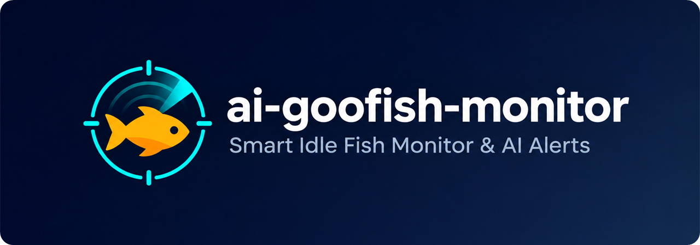

<p align="center">
  
</p>

# AI Goofish Monitor（闲鱼智能监控系统）

简体中文 | [English](README_EN.md)

基于 Playwright、FastAPI、Vue 3 与多模态大模型的闲鱼（Goofish）多任务实时商品监控工具。支持按搜索条件自动巡检闲鱼新发商品，结合商品图文、卖家画像与同关键词市场历史价格进行 AI 筛选（或纯关键词规则快速过滤），命中目标商品后通过 7 种通知渠道即时推送，并提供双语 Web 管理后台。

> 本仓库 fork 自 [Usagi-org/ai-goofish-monitor](https://github.com/Usagi-org/ai-goofish-monitor)。

---

## 核心功能

- **双模式商品判定**
  - **AI 模式（`ai`）**：用自然语言描述购买需求，后台异步生成专属分析标准（`prompts/*_criteria.txt`），运行时综合商品标题、详情、实拍图片、卖家主页画像与市场价格位置给出是否推荐、原因、风险标签及性价比评分。自动兼容 OpenAI Chat Completions API 与 Responses API。
  - **关键词模式（`keyword`）**：无需调用大模型，按单组 OR 逻辑匹配商品与卖家文本；纯英数字关键词自动按完整词边界匹配（例如 `Q1` 不会误命中 `Q1R5`）。
- **细粒度闲鱼搜索筛选**：每个任务独立配置搜索关键词、最低/最高价格、最大翻页数、仅看个人闲置、包邮、新发布时间范围（`最新` / `1天内` / `3天内` / `7天内` / `14天内`）及省/市/区三级区域筛选。
- **卖家画像与价格参考**：自动采集卖家芝麻信用、注册时长、在售/已售列表及历史买卖评价计算好评率（内置 `SellerProfileCache` 缓存去重）；每次搜索自动记录价格快照到 SQLite，计算日均价/中位数走势与单品性价比标签（高性价比 / 值得关注 / 价格正常 / 价格偏高）。
- **多账号登录态与代理池轮换**
  - 配套 Manifest V3 Chrome 插件一键导出 Cookie 与浏览器环境指纹。
  - 任务支持 `auto`（自动选择）、`fixed`（绑定指定账号）、`rotate`（多账号池轮换）三种账号策略，以及 `per_task` / `on_failure` 代理池轮换与临时拉黑（TTL）。
  - 内置任务级失败熔断器（`FailureGuard`）：连续失败达阈值自动暂停并限频告警，更新登录态文件后自动恢复。
- **7 种消息推送渠道**：内置 **ntfy**、**PushPlus**、**Bark**、**Gotify**、**企业微信群机器人**、**Telegram Bot**、**自定义 Webhook**（支持 `GET`/`POST`、`JSON`/`FORM` 与模板占位符），可在 Web 后台直接配置并发送测试通知，支持将桌面端商品链接自动转换为闲鱼手机端分享链接。
- **Vue 3 管理后台（中英双语）**：包含监控概览、任务管理、闲鱼账号管理、结果浏览（支持 AI/关键词筛选、价格趋势图、单条屏蔽、`re:` 正则/关键词黑名单与 CSV 导出）、任务实时日志与系统设置。
- **SQLite 单库存储与平滑迁移**：任务、抓取结果、价格快照与结果黑名单统一存储在 `data/app.sqlite3`（WAL 模式）；首次启动若库为空，会自动从旧版 `config.json`、`jsonl/`、`price_history/` 导入历史数据。

---

## 界面预览

| 监控概览 | 任务管理 |
| :---: | :---: |
|  |  |

| 结果分析与价格趋势 | 消息推送效果 |
| :---: | :---: |
|  |  |

---

## 环境要求

- **Docker 部署（推荐）**：Docker Engine 20.10+ 与 Docker Compose v2（官方镜像已内置 Python 3.11 与 Playwright Chromium，宿主机无需安装浏览器或 Node.js）。
- **本地源码运行**：
  - Python `3.10+`
  - Node.js `20+` 与 `npm`
  - Playwright 及 Chromium 驱动：`python3 -m pip install playwright && python3 -m playwright install chromium`
  - 本地已安装 Google Chrome 或 Microsoft Edge（Linux / WSL 环境也可安装 Chromium）

---

## 快速上手

### 方式一：Docker Compose 启动（推荐）

```bash
git clone https://github.com/hellokiaqi/ai-goofish-monitor.git
cd ai-goofish-monitor

# 必须先创建 .env 文件，否则 Docker 会将 ./.env 挂载点误建为目录
cp .env.example .env
# 编辑 .env，至少填入 OPENAI_API_KEY、OPENAI_BASE_URL、OPENAI_MODEL_NAME

docker compose up -d
docker compose logs -f app
```

国内网络拉取 `ghcr.io` 较慢时，可使用南大镜像加速后启动：

```bash
docker pull ghcr.nju.edu.cn/usagi-org/ai-goofish:latest
docker tag ghcr.nju.edu.cn/usagi-org/ai-goofish:latest ghcr.io/usagi-org/ai-goofish:latest
docker compose up -d
```

- 默认访问地址：`http://127.0.0.1:8000`（默认登录账号密码：`admin` / `admin123`）
- 更新服务：`docker compose pull && docker compose up -d`
- 停止服务：`docker compose down`
- 如果基于本地源码构建开发容器，可使用：`docker compose -f docker-compose.dev.yaml up --build -d`
- 若修改了 `.env` 中的 `SERVER_PORT`，请同步修改 `docker-compose.yaml` 中的 `ports` 映射。

### 方式二：本地一键脚本启动

```bash
cp .env.example .env
chmod +x start.sh
./start.sh
```

`start.sh` 会依次检查 Python 3.10+、Node.js、Playwright 与本地浏览器，安装 `requirements.txt`，在 `web-ui/` 中执行 `npm run build`（构建产物直接输出到仓库根目录 `dist/`），最后启动 `python3 -m src.app`。

### 方式三：前后端分离开发启动

```bash
# 1. 安装后端依赖并启动 FastAPI（默认监听 0.0.0.0:8000）
pip install -r requirements.txt
playwright install chromium
uvicorn src.app:app --host 0.0.0.0 --port 8000 --reload

# 2. 另开终端启动前端 Vite 开发服务器（自动代理 /api、/auth、/ws 到 127.0.0.1:8000）
cd web-ui
npm install
npm run dev
```

生产静态访问需先执行 `cd web-ui && npm run build` 生成根目录 `dist/`，再通过 `http://127.0.0.1:8000` 访问（API 文档位于 `http://127.0.0.1:8000/docs`）。

### 方式四：CLI 爬虫与桌面启动器

不通过 Web 调度器时，也可以直接在命令行运行爬虫入口 [spider_v2.py](spider_v2.py)：

```bash
# 运行 SQLite 数据库中所有已启用的任务
python spider_v2.py

# 仅运行指定名称的任务
python spider_v2.py --task-name "Sony A7M4"

# 调试模式：每个任务最多处理前 3 个新发现的商品（结束后等待回车关闭浏览器）
python spider_v2.py --debug-limit 3

# JSON 兼容模式：显式从指定 JSON 配置文件读取任务（不读 SQLite）
python spider_v2.py --config config.json
```

如需在本机启动服务并自动打开默认浏览器（或配合 PyInstaller 打包桌面端单文件），在构建好根目录 `dist/` 后可运行 [desktop_launcher.py](desktop_launcher.py)：

```bash
python desktop_launcher.py
```

---

## 获取闲鱼登录态与首次配置

1. **准备 Chrome 插件**
   - 直接安装 [Chrome 应用商店扩展](https://chromewebstore.google.com/detail/xianyu-login-state-extrac/eidlpfjiodpigmfcahkmlenhppfklcoa)，或在 Chrome 打开 `chrome://extensions` 开启“开发者模式”，点击“加载已解压的扩展程序”选择本仓库的 [chrome-extension](chrome-extension) 目录（详见 [chrome-extension/README.md](chrome-extension/README.md)）。
2. **导出登录态 JSON**
   - 在浏览器访问 `https://www.goofish.com` 并完成登录。
   - 点击工具栏扩展图标，依次点击 **`1.点击获取环境+登录状态`** -> **`2.点击复制`**。
3. **导入系统**
   - 打开 `http://127.0.0.1:8000` 登录后台，进入 **账号管理 -> 添加账号**，填写账号标识（仅限字母、数字、下划线、短横线）并粘贴 JSON，系统会将其保存为 `state/<名称>.json`。
   - 也可以将 JSON 手动保存为 `state/<名称>.json` 或仓库根目录默认状态文件 `xianyu_state.json`。
4. **创建并运行任务**
   - 进入 **任务管理 -> 创建新任务**：
     - 选择 **AI 模式** 时需填写“详细需求”，提交后弹出进度窗口异步生成 `prompts/<keyword>_criteria.txt`。
     - 选择 **关键词模式** 时直接填写每行/逗号分隔的关键词规则，任务立即创建。
   - 配置定时 Cron（支持 `*/15 * * * *` 等 5 段、带秒 6 段表达式及 `@hourly` / `@daily` 等别名）或手动点击启动。

---

## 环境变量说明（`.env`）

完整配置模板见 [.env.example](.env.example)。在 Web 后台“系统设置”中修改 AI、通知或轮换配置时，后端会自动写回 `.env` 并热重载配置。

### 1. AI 模型、Web 服务与存储

| 变量名 | 默认值 | 必填 | 说明 |
| :--- | :--- | :---: | :--- |
| `OPENAI_BASE_URL` | `""` | 是 | OpenAI 兼容接口地址（使用 AI 模式或 AI 生成标准时必填） |
| `OPENAI_MODEL_NAME` | `""` | 是 | 模型名称；开启商品图片分析时需使用支持视觉输入的模型 |
| `OPENAI_API_KEY` | `""` | 视服务商 | 模型服务 API Key（本地免鉴权服务可留空，云端接口必填） |
| `PROXY_URL` | `""` | 否 | 专用于 AI 请求的代理地址（支持 `http://`、`https://`、`socks5://`） |
| `AI_DEBUG_MODE` | `false` | 否 | 打印 AI 原始请求摘要、响应与解析异常日志 |
| `SKIP_AI_ANALYSIS` | `false` | 否 | 跳过 AI 推理并直接将新商品标记为推荐推送 |
| `ENABLE_THINKING` | `false` | 否 | 设为 `true` 时在请求体附加 `extra_body={"enable_thinking": false}` |
| `ENABLE_RESPONSE_FORMAT` | `true` | 否 | 是否请求 `json_object` 结构化输出（不支持的模型建议设为 `false`） |
| `SERVER_PORT` | `8000` | 否 | FastAPI 监听端口 |
| `WEB_USERNAME` | `admin` | 否 | Web 管理界面登录用户名 |
| `WEB_PASSWORD` | `admin123` | 否 | Web 管理界面登录密码（公网或局域网部署请务必修改） |
| `APP_DATABASE_FILE` | `data/app.sqlite3` | 否 | SQLite 主数据库路径（Docker Compose 默认设为 `/app/data/app.sqlite3`） |

### 2. 爬虫运行、账号/代理轮换与保护

| 变量名 | 默认值 | 说明 |
| :--- | :--- | :--- |
| `RUN_HEADLESS` | `true` | 无头浏览器模式；Docker 容器内必须保持 `true`，本机调试遇滑块可设为 `false` |
| `LOGIN_IS_EDGE` | `false` | 本地环境设为 `true` 时改用 Edge（`msedge`），否则使用 Chrome；Docker 内固定使用 `chromium` |
| `PCURL_TO_MOBILE` | `true` | 推送通知中自动附上闲鱼手机端分享链接（`pages.goofish.com/sharexy...`） |
| `ACCOUNT_STATE_DIR` | `state` | 多账号登录态 JSON 存放目录 |
| `ACCOUNT_ROTATION_ENABLED` | `false` | 是否全局开启多账号轮换 |
| `ACCOUNT_ROTATION_MODE` | `per_task` | 账号轮换时机：`per_task`（按任务随机）或 `on_failure`（失败时切换） |
| `ACCOUNT_ROTATION_RETRY_LIMIT` | `2` | 账号轮换最大尝试次数 |
| `ACCOUNT_BLACKLIST_TTL` | `300` | 失败账号临时拉黑秒数 |
| `PROXY_ROTATION_ENABLED` | `false` | 是否开启爬虫浏览器代理池轮换 |
| `PROXY_ROTATION_MODE` | `per_task` | 代理轮换时机：`per_task` 或 `on_failure` |
| `PROXY_POOL` | `""` | 逗号分隔的浏览器代理列表，如 `http://127.0.0.1:7890,socks5://127.0.0.1:1080` |
| `PROXY_ROTATION_RETRY_LIMIT` | `2` | 代理轮换最大尝试次数 |
| `PROXY_BLACKLIST_TTL` | `300` | 失败代理临时拉黑秒数 |
| `TASK_FAILURE_THRESHOLD` | `3` | 连续失败多少次触发任务自动熔断暂停 |
| `TASK_FAILURE_PAUSE_SECONDS` | `86400` | 任务熔断后的暂停时长（秒，默认 24 小时） |
| `TASK_FAILURE_GUARD_PATH` | `logs/task-failure-guard.json` | 失败熔断状态记录文件路径 |
| `TASK_LOG_RETENTION_DAYS` | `7` | 应用启动时自动清理 `logs/*.log` 超过该天数的历史任务日志 |
| `AI_ANALYSIS_CONCURRENCY` | `2` | 单任务后台并发分析商品数 |
| `SELLER_PROFILE_CACHE_TTL` | `1800` | 同一卖家主页画像缓存有效秒数 |
| `IMAGE_DOWNLOAD_CONCURRENCY` | `3` | 单商品图片并发下载数 |

### 3. 消息通知渠道（按需配置一个或多个）

| 渠道 | 环境变量 | 说明 |
| :--- | :--- | :--- |
| **ntfy** | `NTFY_TOPIC_URL` | 例如 `https://ntfy.sh/your_topic` |
| **PushPlus** | `PUSHPLUS_TOKEN`、`PUSHPLUS_TOPIC`（可选） | 微信消息推送，不填 `PUSHPLUS_TOPIC` 时仅发给本人 |
| **Bark** | `BARK_URL` | iOS 推送地址，例如 `https://api.day.app/your_key` |
| **Gotify** | `GOTIFY_URL`、`GOTIFY_TOKEN` | 两者须成对填写 |
| **企业微信机器人** | `WX_BOT_URL` | 企业微信群 Webhook 完整地址 |
| **Telegram Bot** | `TELEGRAM_BOT_TOKEN`、`TELEGRAM_CHAT_ID`、`TELEGRAM_API_BASE_URL`（可选） | Token 与 Chat ID 须成对填写；API 地址默认 `https://api.telegram.org` |
| **自定义 Webhook** | `WEBHOOK_URL`、`WEBHOOK_METHOD`、`WEBHOOK_CONTENT_TYPE`、`WEBHOOK_HEADERS`、`WEBHOOK_QUERY_PARAMETERS`、`WEBHOOK_BODY` | 支持 `GET`/`POST` 与 `JSON`/`FORM`；模板可用 `{{title}}`、`{{content}}`、`{{price}}`、`{{reason}}`、`{{desktop_link}}`、`{{mobile_link}}`（或 `${...}` 语法） |

---

## 目录结构

```text
ai-goofish-monitor/
├── src/
│   ├── app.py                        # FastAPI 应用主入口、生命周期与 SPA 静态托管
│   ├── config.py                     # 爬虫子进程环境变量与 OpenAI 客户端初始化
│   ├── scraper.py                    # Playwright 搜索、筛选、翻页、详情与卖家主页采集
│   ├── ai_handler.py                 # 商品图片并发下载、多模态 AI 分析与通知分发
│   ├── keyword_rule_engine.py        # 关键词 OR 匹配引擎（含英数字词边界保护）
│   ├── parsers.py                    # 闲鱼搜索/用户主页/商品/评价接口 JSON 解析器
│   ├── prompt_utils.py               # 基于参考模板异步调用 AI 生成任务分析标准
│   ├── rotation.py                   # 账号与代理池随机选取及黑名单 TTL 管理
│   ├── failure_guard.py              # 任务连续失败熔断与 Cookie 更新自动恢复
│   ├── api/                          # FastAPI 依赖注入与 REST / WebSocket 路由
│   ├── services/                     # 任务、子进程、APScheduler、结果、价格趋势、通知等业务服务
│   ├── domain/                       # Task / TaskGenerationJob 领域模型与仓储抽象
│   └── infrastructure/               # Pydantic 配置、.env 读写、SQLite 持久化、AI 与 7 种通知客户端
├── spider_v2.py                      # 爬虫 CLI 入口（亦由 ProcessService 作为子进程拉起）
├── desktop_launcher.py               # 本机 / PyInstaller 桌面单文件启动入口
├── web-ui/                           # Vue 3 + TypeScript + Vite + Tailwind + Reka UI 前端（详见 web-ui/README.md）
├── chrome-extension/                 # Manifest V3 闲鱼登录态提取扩展（详见 chrome-extension/README.md）
├── prompts/                          # 基础提示词模板 base_prompt.txt 与各任务 *_criteria.txt
├── tests/                            # 单元、集成与真实流量冒烟测试（详见 tests/README.md）
├── data/                             # 运行时生成的 SQLite 主库（app.sqlite3）
├── state/                            # 多账号登录态 JSON 目录
├── logs/                             # 任务运行日志、AI 请求摘要与熔断状态文件
└── images/                           # 任务运行时临时商品图片目录（结束后自动清理）
```

---

## 测试与校验

完整测试分层与参数说明见 [tests/README.md](tests/README.md)。

```bash
# 运行离线单元与集成测试（默认跳过 live 真实流量测试；禁用第三方插件自动加载避免干扰）
PYTEST_DISABLE_PLUGIN_AUTOLOAD=1 pytest

# 生成代码覆盖率报告
PYTEST_DISABLE_PLUGIN_AUTOLOAD=1 coverage run -m pytest && coverage report

# 校验前端 TypeScript 类型与生产构建（输出到根目录 dist/）
cd web-ui && npm run build

# 运行真实流量冒烟测试（需有效 state/*.json 与 .env 中的 AI 配置）
./run_live_smoke.sh --without-generation
```

---

## 常见问题排查

1. **打开 `http://127.0.0.1:8000` 报错“前端构建产物不存在”**
   - 仓库根目录缺少 `dist/index.html`。请在 `web-ui/` 目录执行 `npm install && npm run build`（`vite.config.ts` 会直接把产物构建到根目录 `dist/`），或直接运行 `./start.sh`。
2. **`./start.sh` 提示缺少 Playwright 或浏览器**
   - 本地模式通过 Playwright 调用系统 Chrome / Edge（Linux 支持 Chromium）。请先执行 `python3 -m pip install playwright && python3 -m playwright install chromium` 并安装 Chrome 或 Edge。若不想在宿主机装浏览器，请改用 Docker Compose。
3. **任务日志出现 `passport.goofish.com`、`mini_login`、`baxia-dialog` 或 `FAIL_SYS_USER_VALIDATE`**
   - 登录态已过期或触发闲鱼滑块/风控。请重新在浏览器打开闲鱼刷新页面，用 Chrome 扩展重新提取登录态并更新对应账号；同时适当拉长 Cron 间隔、减少单次 `max_pages`。本地排查验证码可临时在 `.env` 设置 `RUN_HEADLESS=false`。
4. **AI 创建任务或商品分析报错 / 返回空内容**
   - 先到 **系统设置 -> AI 模型配置** 点击“测试连接”。
   - 若使用豆包等不支持 `json_object` 参数的模型，虽然客户端内置了自动降级重试，仍可在 `.env` 中显式设 `ENABLE_RESPONSE_FORMAT=false`。
   - 若使用长推理（Thinking）模型导致生成标准被截断，可更换非推理模型或调高网关允许的最大输出 Token。
5. **区域筛选后搜不到商品**
   - 闲鱼的区域筛选本身会大幅缩小结果集。建议先留空区域验证关键词与价格区间正常出结果，再按需细化省/市/区。
6. **Web 登录认证安全性说明**
   - 当前 Web 登录页通过 `POST /auth/status` 校验 `WEB_USERNAME` / `WEB_PASSWORD` 并在前端维护路由状态，`/api/*` 接口本身未挂载后端鉴权中间件。**请勿将 8000 端口直接裸露在公网**；如需远程访问，请务必修改默认密码，并配合反向代理 Basic Auth / OAuth、VPN 或防火墙白名单限制来源。

---

## 安全合规与免责声明

- 本项目采用 [MIT License](LICENSE) 开源，**仅供个人技术学习与研究使用**。
- 请严格遵守闲鱼（Goofish）平台用户协议及相关法律法规，合理控制抓取频率，切勿用于商业牟利、恶意抓取或任何违法违规用途。账号风控、限制等风险由使用者自行承担。
- 使用本软件前请务必完整阅读 [免责声明（DISCLAIMER.md）](DISCLAIMER.md)。
- 切勿将包含真实密钥与 Cookie 的 `.env`、`xianyu_state.json`、`state/*.json` 提交到公开代码仓库。

---

## 致谢

- 参考项目：[superboyyy/xianyu_spider](https://github.com/superboyyy/xianyu_spider)
- 感谢 [@jooooody](https://linux.do/u/jooooody/summary) 与 [LinuxDo](https://linux.do/) 社区成员的脚本与经验分享。

## Star History

[](https://www.star-history.com/#Usagi-org/ai-goofish-monitor&Date)
