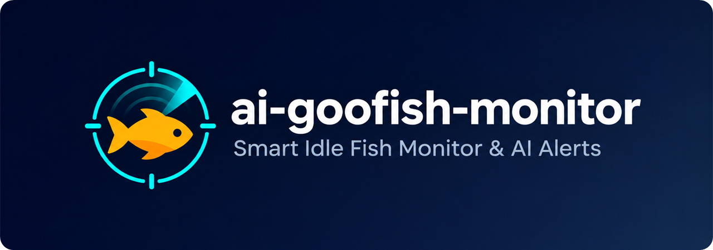

<p align="center">
  
</p>

# AI Goofish Monitor

[简体中文](README.md) | English

A multi-task real-time item monitor for Goofish (Xianyu / 闲鱼) built with Playwright, FastAPI, Vue 3, and OpenAI-compatible multimodal LLMs. It watches search queries on a schedule, evaluates new listings using either multimodal AI analysis (item images + seller profile + historical market prices) or local keyword rules, pushes instant alerts across 7 notification channels, and provides a bilingual (`zh-CN` / `en-US`) web dashboard backed by SQLite.

> Forked from [Usagi-org/ai-goofish-monitor](https://github.com/Usagi-org/ai-goofish-monitor).

---

## Key Features

- **Two Evaluation Modes**
  - **AI Mode (`ai`)**: Describe what you want in plain language. A background job generates custom inspection criteria (`prompts/*_criteria.txt`), and each new listing is evaluated with its description, downloaded photos, seller profile, and market price position to output a recommendation verdict, reasoning, risk tags, and deal score. Automatically adapts between OpenAI Chat Completions API and Responses API.
  - **Keyword Mode (`keyword`)**: Fast local OR-matching across item and seller text without LLM calls. Pure ASCII alphanumeric keywords use word-boundary matching so `Q1` does not falsely match `Q1R5`.
- **Granular Goofish Search Filters**: Per-task keyword, min/max price, max pages, personal idle items only (`个人闲置`), free shipping (`包邮`), publish recency (`最新` / `1天内` / `3天内` / `7天内` / `14天内`), and a built-in 3-level province/city/district selector.
- **Seller Profiling & Price Insights**: Scrapes seller Zhima credit, account age, active/sold listings, and buyer/seller rating history (`SellerProfileCache` avoids redundant fetches). Records search price snapshots into SQLite to compute daily average/median trends and per-item deal scores.
- **Multi-Account Management, Proxy Rotation & Circuit Breaker**
  - Ships with a Manifest V3 Chrome extension to export cookies and browser environment fingerprints in two clicks.
  - Supports `auto`, `fixed`, and `rotate` account strategies per task, plus `per_task` / `on_failure` proxy pool rotation with temporary blacklisting (TTL).
  - Built-in task circuit breaker (`FailureGuard`): pauses tasks after consecutive failures, rate-limits failure alerts to once per day, and automatically resumes when the bound login-state file is updated.
- **7 Notification Channels**: Supports **ntfy**, **PushPlus**, **Bark**, **Gotify**, **WeCom Bot (企业微信)**, **Telegram Bot**, and **Custom Webhook** (`GET`/`POST`, `JSON`/`FORM`, template placeholders). Configure and send test notifications directly from the Web UI, with optional conversion of desktop item links to mobile share links.
- **Bilingual Vue 3 Web Console**: Includes Dashboard, Tasks, Goofish Accounts, Results (AI/keyword filters, price trend charts, manual item hiding, plain/regex `re:` blacklist rules, CSV export), Live Task Logs, and System Settings.
- **SQLite Primary Storage & Legacy Import**: Tasks, crawled results, price snapshots, and blacklist rules live in `data/app.sqlite3` (WAL mode). On first startup, empty tables automatically import legacy data from `config.json`, `jsonl/`, and `price_history/`.

---

## Screenshots

| Dashboard Overview | Task Management |
| :---: | :---: |
|  |  |

| Results & Price Trends | Push Notification |
| :---: | :---: |
|  |  |

---

## Requirements

- **Docker Deployment (Recommended)**: Docker Engine 20.10+ and Docker Compose v2. The official image bundles Python 3.11 and Playwright Chromium—no host browser or Node.js required.
- **Local Source Setup**:
  - Python `3.10+`
  - Node.js `20+` and `npm`
  - Playwright CLI & Chromium: `python3 -m pip install playwright && python3 -m playwright install chromium`
  - Google Chrome or Microsoft Edge installed locally (Chromium is also supported on Linux / WSL)

---

## Quick Start

### Option 1: Docker Compose (Recommended)

```bash
git clone https://github.com/hellokiaqi/ai-goofish-monitor.git
cd ai-goofish-monitor

# Create .env before starting so Docker mounts it as a file rather than creating a directory
cp .env.example .env
# Edit .env and set OPENAI_API_KEY, OPENAI_BASE_URL, and OPENAI_MODEL_NAME

docker compose up -d
docker compose logs -f app
```

If pulling from `ghcr.io` is slow in mainland China, pull via the NJU mirror first:

```bash
docker pull ghcr.nju.edu.cn/usagi-org/ai-goofish:latest
docker tag ghcr.nju.edu.cn/usagi-org/ai-goofish:latest ghcr.io/usagi-org/ai-goofish:latest
docker compose up -d
```

- Default Web UI: `http://127.0.0.1:8000` (default credentials: `admin` / `admin123`)
- Update image: `docker compose pull && docker compose up -d`
- Stop container: `docker compose down`
- Local source build with Docker: `docker compose -f docker-compose.dev.yaml up --build -d`
- If you change `SERVER_PORT` in `.env`, update the `ports` mapping in `docker-compose.yaml` to match.

### Option 2: One-Click Local Script

```bash
cp .env.example .env
chmod +x start.sh
./start.sh
```

`start.sh` checks Python 3.10+, Node.js, Playwright, and a local browser, installs `requirements.txt`, runs `npm run build` in `web-ui/` (which outputs directly to the repository root `dist/`), and launches `python3 -m src.app`.

### Option 3: Manual Frontend & Backend Dev Mode

```bash
# 1. Install backend dependencies and run FastAPI (listens on 0.0.0.0:8000)
pip install -r requirements.txt
playwright install chromium
uvicorn src.app:app --host 0.0.0.0 --port 8000 --reload

# 2. In another terminal, start the Vite dev server (proxies /api, /auth, /ws to 127.0.0.1:8000)
cd web-ui
npm install
npm run dev
```

To serve the frontend directly from FastAPI on port `8000`, run `cd web-ui && npm run build` first so `dist/` is generated at the repository root. Swagger API docs are available at `http://127.0.0.1:8000/docs`.

### Option 4: CLI Scraper & Desktop Launcher

You can run the scraper directly without the web scheduler via [spider_v2.py](spider_v2.py):

```bash
# Run all enabled tasks stored in SQLite
python spider_v2.py

# Run a single task by name
python spider_v2.py --task-name "Sony A7M4"

# Debug mode: process at most 3 new items per task (waits for Enter before closing browser)
python spider_v2.py --debug-limit 3

# Legacy JSON mode: load tasks explicitly from a JSON file instead of SQLite
python spider_v2.py --config config.json
```

To start FastAPI on `127.0.0.1` and open the default browser automatically (also used as the PyInstaller single-file entry point), build `dist/` and run [desktop_launcher.py](desktop_launcher.py):

```bash
python desktop_launcher.py
```

---

## Capturing Goofish Login State & First Run

1. **Install the Chrome Extension**
   - Install from the [Chrome Web Store](https://chromewebstore.google.com/detail/xianyu-login-state-extrac/eidlpfjiodpigmfcahkmlenhppfklcoa), or open `chrome://extensions`, enable **Developer mode**, click **Load unpacked**, and select the [chrome-extension](chrome-extension) directory (see [chrome-extension/README.md](chrome-extension/README.md)).
2. **Export the Session Snapshot**
   - Sign in at `https://www.goofish.com`.
   - Click the extension icon in your toolbar, click **`1.点击获取环境+登录状态`** to capture cookies + browser environment, then click **`2.点击复制`**.
3. **Import into the App**
   - Sign in at `http://127.0.0.1:8000`, open **Accounts -> Add Account**, enter an account name (letters, digits, `_`, `-`), and paste the JSON. It is saved to `state/<name>.json`.
   - Alternatively, save the JSON manually to `state/<name>.json` or `xianyu_state.json` in the repo root.
4. **Create and Start a Task**
   - Go to **Tasks -> Create Task**:
     - **AI Mode**: describe your buying criteria in plain language; a progress dialog tracks async generation of `prompts/<keyword>_criteria.txt`.
     - **Keyword Mode**: enter newline- or comma-separated keywords to create the task immediately.
   - Set a Cron schedule (supports 5-field, 6-field with seconds, and aliases like `@hourly` / `@daily`) or start the task manually.

---

## Environment Variables (`.env`)

See [.env.example](.env.example) for the complete template. Saving AI, notification, or rotation settings in the Web UI updates `.env` and reloads runtime settings automatically.

### 1. AI Model, Web Server & Storage

| Variable | Default | Required | Description |
| :--- | :--- | :---: | :--- |
| `OPENAI_BASE_URL` | `""` | Yes | OpenAI-compatible API base URL (required for AI mode & criteria generation) |
| `OPENAI_MODEL_NAME` | `""` | Yes | Model identifier; must support vision input when image analysis is enabled |
| `OPENAI_API_KEY` | `""` | Provider-dependent | API key (required by cloud providers; optional for local unauthenticated gateways) |
| `PROXY_URL` | `""` | No | Dedicated proxy for AI API requests (`http://`, `https://`, `socks5://`) |
| `AI_DEBUG_MODE` | `false` | No | Print detailed AI request summaries, raw responses, and parse errors |
| `SKIP_AI_ANALYSIS` | `false` | No | Skip LLM inference and mark every new listing as recommended |
| `ENABLE_THINKING` | `false` | No | Attach `extra_body={"enable_thinking": false}` when `true` |
| `ENABLE_RESPONSE_FORMAT` | `true` | No | Request structured `json_object` output (set `false` for incompatible models) |
| `SERVER_PORT` | `8000` | No | FastAPI listening port |
| `WEB_USERNAME` | `admin` | No | Web UI login username |
| `WEB_PASSWORD` | `admin123` | No | Web UI login password (change before exposing on any network) |
| `APP_DATABASE_FILE` | `data/app.sqlite3` | No | SQLite database file path (`/app/data/app.sqlite3` in Docker Compose) |

### 2. Scraper Runtime, Rotation & Failure Guard

| Variable | Default | Description |
| :--- | :--- | :--- |
| `RUN_HEADLESS` | `true` | Run Playwright headless; keep `true` in Docker, set `false` locally to inspect captchas |
| `LOGIN_IS_EDGE` | `false` | Launch `msedge` instead of `chrome` locally; Docker always uses bundled `chromium` |
| `PCURL_TO_MOBILE` | `true` | Include Goofish mobile share URLs (`pages.goofish.com/sharexy...`) in notifications |
| `ACCOUNT_STATE_DIR` | `state` | Directory storing multi-account JSON state files |
| `ACCOUNT_ROTATION_ENABLED` | `false` | Enable multi-account rotation globally |
| `ACCOUNT_ROTATION_MODE` | `per_task` | Rotation trigger: `per_task` or `on_failure` |
| `ACCOUNT_ROTATION_RETRY_LIMIT` | `2` | Max account rotation attempts per run |
| `ACCOUNT_BLACKLIST_TTL` | `300` | Temporary blacklist duration (seconds) for failed accounts |
| `PROXY_ROTATION_ENABLED` | `false` | Enable scraper browser proxy pool rotation |
| `PROXY_ROTATION_MODE` | `per_task` | Proxy rotation trigger: `per_task` or `on_failure` |
| `PROXY_POOL` | `""` | Comma-separated proxy URLs, e.g. `http://127.0.0.1:7890,socks5://127.0.0.1:1080` |
| `PROXY_ROTATION_RETRY_LIMIT` | `2` | Max proxy rotation attempts per run |
| `PROXY_BLACKLIST_TTL` | `300` | Temporary blacklist duration (seconds) for failed proxies |
| `TASK_FAILURE_THRESHOLD` | `3` | Consecutive failures before `FailureGuard` pauses the task |
| `TASK_FAILURE_PAUSE_SECONDS` | `86400` | Pause duration in seconds after circuit breaker trips (default 24h) |
| `TASK_FAILURE_GUARD_PATH` | `logs/task-failure-guard.json` | File storing task failure circuit-breaker state |
| `TASK_LOG_RETENTION_DAYS` | `7` | Delete `logs/*.log` files older than N days on startup |
| `AI_ANALYSIS_CONCURRENCY` | `2` | Max concurrent item analyses per running task |
| `SELLER_PROFILE_CACHE_TTL` | `1800` | Cache TTL in seconds for scraped seller profiles |
| `IMAGE_DOWNLOAD_CONCURRENCY` | `3` | Max concurrent image downloads per item |

### 3. Notification Channels (Configure Any Combination)

| Channel | Environment Variables | Notes |
| :--- | :--- | :--- |
| **ntfy** | `NTFY_TOPIC_URL` | e.g. `https://ntfy.sh/your_topic` |
| **PushPlus** | `PUSHPLUS_TOKEN`, `PUSHPLUS_TOPIC` (optional) | WeChat push service; omit `PUSHPLUS_TOPIC` for personal delivery |
| **Bark** | `BARK_URL` | iOS push endpoint, e.g. `https://api.day.app/your_key` |
| **Gotify** | `GOTIFY_URL`, `GOTIFY_TOKEN` | Must be configured as a pair |
| **WeCom Bot** | `WX_BOT_URL` | Enterprise WeChat group bot webhook URL |
| **Telegram Bot** | `TELEGRAM_BOT_TOKEN`, `TELEGRAM_CHAT_ID`, `TELEGRAM_API_BASE_URL` (optional) | Token & Chat ID must be paired; base URL defaults to `https://api.telegram.org` |
| **Custom Webhook** | `WEBHOOK_URL`, `WEBHOOK_METHOD`, `WEBHOOK_CONTENT_TYPE`, `WEBHOOK_HEADERS`, `WEBHOOK_QUERY_PARAMETERS`, `WEBHOOK_BODY` | `GET`/`POST`, `JSON`/`FORM`; supports `{{title}}`, `{{content}}`, `{{price}}`, `{{reason}}`, `{{desktop_link}}`, `{{mobile_link}}` (or `${...}`) |

---

## Project Structure

```text
ai-goofish-monitor/
├── src/
│   ├── app.py                        # FastAPI entry point, lifespan hooks, and SPA static serving
│   ├── config.py                     # Scraper child-process env config and OpenAI client setup
│   ├── scraper.py                    # Playwright search, filtering, pagination, item & seller scraping
│   ├── ai_handler.py                 # Concurrent image downloads, multimodal AI calls, and alert dispatch
│   ├── keyword_rule_engine.py        # OR keyword matcher with ASCII word-boundary checks
│   ├── parsers.py                    # Goofish search, seller header, item list, and rating JSON parsers
│   ├── prompt_utils.py               # Async AI criteria generator using reference prompt templates
│   ├── rotation.py                   # Account & proxy pool selection with TTL blacklisting
│   ├── failure_guard.py              # Task failure circuit breaker with auto-recovery on cookie update
│   ├── api/                          # FastAPI dependency injection, REST routes, and WebSocket endpoint
│   ├── services/                     # Task, subprocess, APScheduler, results, price history, and notification services
│   ├── domain/                       # Task & TaskGenerationJob models and repository interface
│   └── infrastructure/               # Pydantic settings, .env manager, SQLite storage, AI & 7 notification clients
├── spider_v2.py                      # Scraper CLI entry point (spawned per task by ProcessService)
├── desktop_launcher.py               # Local / PyInstaller single-binary launcher
├── web-ui/                           # Vue 3 + TypeScript + Vite + Tailwind + Reka UI frontend (see web-ui/README.md)
├── chrome-extension/                 # Manifest V3 Goofish login-state extractor (see chrome-extension/README.md)
├── prompts/                          # Base prompt (base_prompt.txt) and generated *_criteria.txt files
├── tests/                            # Unit, integration, and live smoke test suites (see tests/README.md)
├── data/                             # SQLite database directory (app.sqlite3)
├── state/                            # Multi-account login-state JSON files
├── logs/                             # Per-task logs, AI request summaries, and failure-guard state
└── images/                           # Temporary product images per task (cleaned up after analysis)
```

---

## Testing & Verification

See [tests/README.md](tests/README.md) for test layers, fixtures, and live smoke options.

```bash
# Run offline unit and integration tests (skips live tests by default; disables external pytest plugins)
PYTEST_DISABLE_PLUGIN_AUTOLOAD=1 pytest

# Measure test coverage
PYTEST_DISABLE_PLUGIN_AUTOLOAD=1 coverage run -m pytest && coverage report

# Type-check and build the frontend into root dist/
cd web-ui && npm run build

# Run real-traffic live smoke tests (requires a valid state/*.json and AI config in .env)
./run_live_smoke.sh --without-generation
```

---

## Troubleshooting

1. **`http://127.0.0.1:8000` returns `"前端构建产物不存在"` (frontend build missing)**
   - The root `dist/index.html` has not been built yet. Run `cd web-ui && npm install && npm run build` (`vite.config.ts` writes directly to `../dist`), or start with `./start.sh`.
2. **`./start.sh` reports missing Playwright or browser**
   - Local runs launch system Chrome or Edge (or Chromium on Linux) via Playwright. Run `python3 -m pip install playwright && python3 -m playwright install chromium` and install Chrome/Edge, or use Docker Compose instead.
3. **Task logs show `passport.goofish.com`, `mini_login`, `baxia-dialog`, or `FAIL_SYS_USER_VALIDATE`**
   - Your login state expired or triggered Goofish anti-bot verification. Refresh `goofish.com` in your browser, re-export the login state via the Chrome extension, update the account in Web UI, and reduce task frequency or `max_pages`. For local debugging, set `RUN_HEADLESS=false` in `.env`.
4. **AI task generation or item analysis fails**
   - Test connectivity in **Settings -> AI** first.
   - Although the client automatically retries without `json_object` on unsupported gateways, you can explicitly set `ENABLE_RESPONSE_FORMAT=false` in `.env`.
   - If a reasoning model truncates criteria output inside `<think>` tags, switch to a standard non-reasoning model or increase the gateway's max output token limit.
5. **Region filter returns zero items**
   - Goofish region filters narrow results sharply. Leave the region empty first to confirm your keyword and price filters return listings, then narrow down by province/city/district.
6. **Web UI authentication scope**
   - `POST /auth/status` validates `WEB_USERNAME` / `WEB_PASSWORD` for the frontend login gate, while `/api/*` endpoints do not enforce backend session middleware. **Do not expose port 8000 directly to the public internet**—always change the default password and place the service behind a reverse proxy with authentication, a VPN, or firewall IP allowlists.

---

## Security & Disclaimer

- Released under the [MIT License](LICENSE) strictly for **personal learning and technical research**.
- Respect Goofish's Terms of Service and all applicable laws. Keep polling intervals reasonable and never use this software for commercial scraping or unlawful activities. You are solely responsible for any account restrictions or consequences.
- Read the full [Disclaimer (DISCLAIMER.md)](DISCLAIMER.md) before using this project.
- Never commit `.env`, `xianyu_state.json`, or `state/*.json` containing real API keys or session cookies.

---

## Acknowledgments

- Inspired by [superboyyy/xianyu_spider](https://github.com/superboyyy/xianyu_spider)
- Special thanks to [@jooooody](https://linux.do/u/jooooody/summary) and the [LinuxDo](https://linux.do/) community.

## Star History

[](https://www.star-history.com/#Usagi-org/ai-goofish-monitor&Date)
